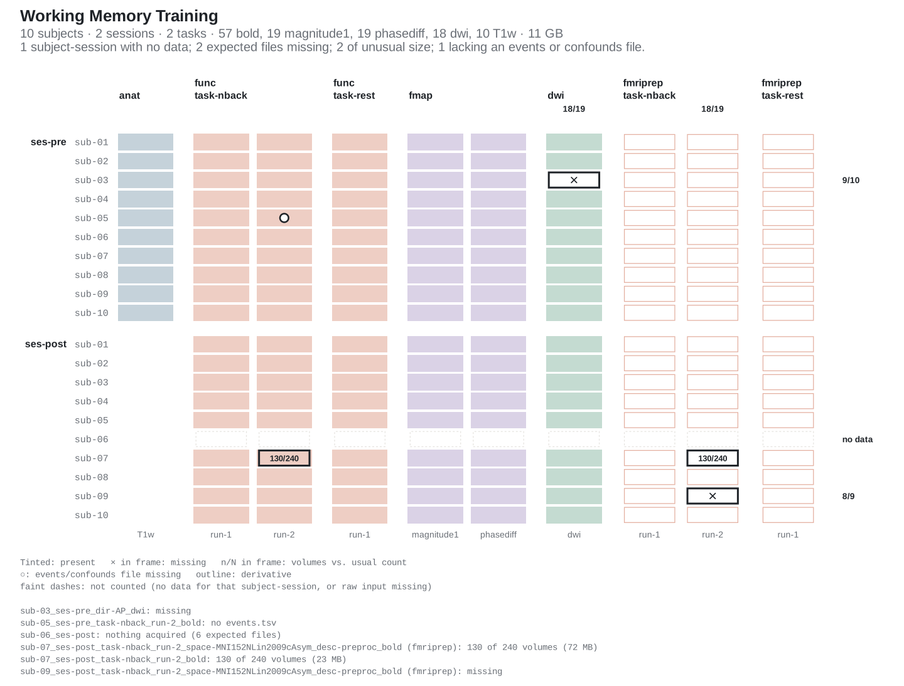
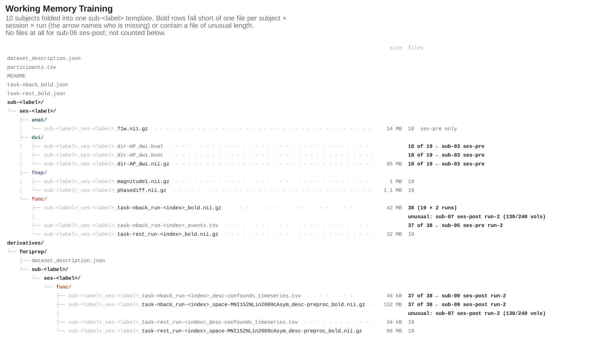
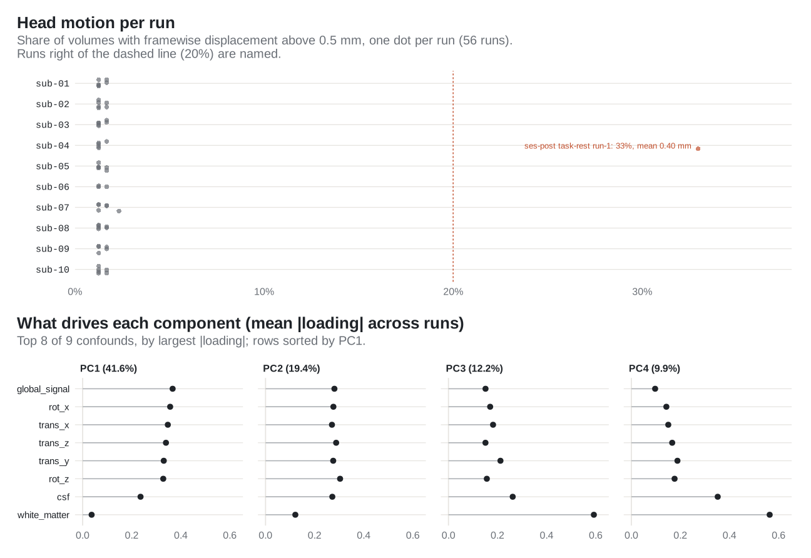

<!-- README.md is generated from README.Rmd. Please edit that file -->

# bidser

<!-- badges: start -->

[](https://CRAN.R-project.org/package=bidser)
[](https://github.com/bbuchsbaum/bidser/actions/workflows/R-CMD-check.yaml)
[](https://bbuchsbaum.github.io/bidser/)
[](https://app.codecov.io/gh/bbuchsbaum/bidser?branch=master)
<!-- badges: end -->

**bidser** reads a [BIDS](https://bids.neuroimaging.io/) (Brain Imaging
Data Structure) dataset into R and answers the questions that come
before any analysis:

- what is in the dataset, and is anything missing or malformed;
- where the files for a given subject, session, task and run are;
- what the sidecar metadata say, with BIDS inheritance applied;
- which derivative pipelines (fMRIPrep and others) have run, and on
  what;
- which confound regressors to use, and whether head motion is a
  problem.

It works on the directory as it sits on disk, with no Python, external
validator or imaging package required.

[Documentation](https://bbuchsbaum.github.io/bidser/) · [Getting
started](https://bbuchsbaum.github.io/bidser/articles/quickstart.html) ·
[Derivatives](https://bbuchsbaum.github.io/bidser/articles/derivatives.html)
· [Confounds and
variables](https://bbuchsbaum.github.io/bidser/articles/confounds-and-variables.html)
· [Mock
projects](https://bbuchsbaum.github.io/bidser/articles/mock-bids.html) ·
[Reference](https://bbuchsbaum.github.io/bidser/reference/) ·
[Changelog](NEWS.md)

## Installation

``` r
install.packages("bidser")                    # CRAN release
remotes::install_github("bbuchsbaum/bidser")  # development version
```

## Open a dataset

Point `bids_project()` at the dataset root. `derivatives = "auto"` also
picks up any pipelines under `derivatives/`.

``` r
library(bidser)

proj <- bids_project(path, derivatives = "auto")
proj
#> BIDS Project Summary 
#> Project Name:  Working Memory Training (wm-training) 
#> Participants (n):  10 
#> Participants Source:  file 
#> Tasks:  nback, rest 
#> Sessions:  post, pre 
#> fMRIPrep Derivatives:  derivatives/fmriprep 
#> Derivative Pipelines:  fmriprep 
#> Index:  enabled 
#> Image Types:  func, fmap, dwi, anat, funcprep 
#> Keys:  session, folder, kind, relative_path, run, subid, suffix, task, type, dir, desc, space
```

The examples on this page run on a small demonstration dataset: a
two-session working-memory study with 10 subjects, `anat`, `func`,
`fmap` and `dwi` data, and fMRIPrep output. It is written by
[`data-raw/readme-dataset.R`](data-raw/readme-dataset.R) and has a few
planted problems so the checks below have something to find. Any BIDS
directory works the same way, and `get_example_bids_dataset("ds001")`
downloads a real one.

## See what is there, and what is not

`plot_bids()` draws one row per subject (grouped by session) and one
column per acquisition (grouped by datatype, task and pipeline). Files
that are present are drawn pale, so the dark marks are the problems. A
cross marks a missing file. A framed fraction marks a run with fewer
volumes than its column usually has, read from the NIfTI header. A ring
marks a run without its `events.tsv`. Every problem is listed under the
plot by BIDS file name.

``` r
plot_bids(proj, interactive = FALSE)
```



`plot_bids_tree()` shows the same dataset as a file layout. Every
subject is folded into one `sub-<label>` template, and each file line
gives its count and names whoever is missing.

``` r
plot_bids_tree(proj)
```



For the same checks as data rather than pictures, see `bids_report()`,
`bids_summary()` and `bids_check_compliance()`.

## Find files by entity

`query_files()` filters on any BIDS entity and can return a tibble of
parsed entities instead of paths. Filters are regular expressions by
default; `match_mode = "exact"` and `"glob"` are also available.

``` r
query_files(proj, regex = "bold\\.nii\\.gz$", subid = "01", task = "nback",
            scope = "raw", return = "tibble")[, c("subid", "session", "task", "run", "kind")]
#> # A tibble: 4 × 5
#>   subid session task  run   kind 
#>   <chr> <chr>   <chr> <chr> <chr>
#> 1 01    post    nback 1     bold 
#> 2 01    post    nback 2     bold 
#> 3 01    pre     nback 1     bold 
#> 4 01    pre     nback 2     bold
```

Convenience wrappers cover the common cases: `func_scans()`,
`event_files()`, `preproc_scans()`, `confound_files()`, `mask_files()`.

## Metadata, volumes and events

`get_metadata()` resolves a file’s sidecar with BIDS inheritance, so a
`RepetitionTime` set once in `task-nback_bold.json` at the dataset root
applies to every run:

``` r
bold <- func_scans(proj, subid = "01", task = "nback", session = "pre", run = "1")
get_metadata(proj, bold)[c("TaskName", "RepetitionTime")]
#> $TaskName
#> [1] "nback"
#> 
#> $RepetitionTime
#> [1] 2
```

`n_volumes()` reads volume counts from the image headers. Here it shows
the run that stopped early:

``` r
n_volumes(proj, subid = "07", session = "post", task = "nback", as_tibble = TRUE)[
  , c("subid", "session", "run", "nvols")]
#> # A tibble: 2 × 4
#>   subid session   run nvols
#>   <chr> <chr>   <int> <int>
#> 1 07    post        1   240
#> 2 07    post        2   130
```

`read_events()` returns each run’s `events.tsv` nested by subject,
session, task and run:

``` r
read_events(proj, subid = "01", session = "pre", task = "nback")
#> # A tibble: 2 × 9
#> # Groups:   .task, .session, .run, .subid [2]
#>   .task .session .run  .subid task  session run   participant_id data             
#>   <chr> <chr>    <chr> <chr>  <chr> <chr>   <chr> <chr>          <list>           
#> 1 nback pre      1     01     nback pre     1     01             <tibble [16 × 5]>
#> 2 nback pre      2     01     nback pre     2     01             <tibble [16 × 5]>
```

## Derivatives

Pipelines under `derivatives/` are discovered from their
`dataset_description.json`, and every query can be scoped to raw data,
to derivatives, or to one pipeline:

``` r
derivative_pipelines(proj)[, c("pipeline", "root")]
#> # A tibble: 1 × 2
#>   pipeline root                
#>   <chr>    <chr>               
#> 1 fmriprep derivatives/fmriprep

query_files(proj, regex = "desc-preproc_bold", scope = "derivatives",
            pipeline = "fmriprep", subid = "09", session = "post")
#> [1] "derivatives/fmriprep/sub-09/ses-post/func/sub-09_ses-post_task-nback_run-1_space-MNI152NLin2009cAsym_desc-preproc_bold.nii.gz"
#> [2] "derivatives/fmriprep/sub-09/ses-post/func/sub-09_ses-post_task-rest_run-1_space-MNI152NLin2009cAsym_desc-preproc_bold.nii.gz"
```

Only two preprocessed runs are returned for sub-09 ses-post, where three
were expected. That is the failed run marked in the matrix above.

## Confounds and head motion

`read_confounds()` reads fMRIPrep confound tables, selecting columns by
named sets that adapt to the fMRIPrep version
(`confound_set("motion24")`, `"36p"`, `"acompcor"`, …) or reducing them
with a PCA strategy:

``` r
read_confounds(proj, subid = "01", session = "pre", cvars = confound_set("motion6"))
#> # A tibble: 3 × 5
#> # Groups:   participant_id, task, run, session [3]
#>   participant_id task  run   session data              
#>   <chr>          <chr> <chr> <chr>   <list>            
#> 1 01             nback 1     pre     <tibble [240 × 6]>
#> 2 01             nback 2     pre     <tibble [240 × 6]>
#> 3 01             rest  1     pre     <tibble [180 × 6]>
```

Keep framewise displacement as a raw column and `plot()` leads with head
motion. Each dot is one run, placed by the share of its volumes above
the threshold (0.5 mm by default):

``` r
strategy <- confound_strategy(
  pca_vars = c("global_signal", "csf", "white_matter", "trans_*", "rot_*"),
  raw_vars = "framewise_displacement",
  npcs = 4
)
plot(read_confounds(proj, cvars = strategy), view = "aggregate")
```



`list_confound_sets()` and `list_confound_strategies()` list the
built-in options. Code that used the unexported
`bidser:::DEFAULT_CVARS2` should switch to
`confound_set("legacy_default")`, which returns the same 26 columns.

## Testing code without data

`create_mock_bids()` builds an in-memory project from a table of files.
It can optionally write zero-byte stubs (plus event and confound tables)
to disk. The query, event, confound and plotting functions accept it, so
analysis code can be tested without downloading anything:

``` r
mock <- create_mock_bids(
  project_name = "demo",
  participants = c("01", "02"),
  file_structure = data.frame(
    subid = c("01", "02"), datatype = "func", task = "rest", run = "01",
    suffix = "bold.nii.gz", fmriprep = FALSE
  )
)
func_scans(mock)
#> [1] "demo/sub-01/func/sub-01_task-rest_run-01_bold.nii.gz"
#> [2] "demo/sub-02/func/sub-02_task-rest_run-01_bold.nii.gz"
```

## Learn more

- [Getting
  started](https://bbuchsbaum.github.io/bidser/articles/quickstart.html):
  querying a real dataset (ds001) end to end.
- [Derivatives](https://bbuchsbaum.github.io/bidser/articles/derivatives.html):
  pipeline discovery, scoped queries, run-level readiness checks.
- [Confounds and
  variables](https://bbuchsbaum.github.io/bidser/articles/confounds-and-variables.html):
  confound sets, PCA strategies, events and the per-run variables table.
- [Mock
  projects](https://bbuchsbaum.github.io/bidser/articles/mock-bids.html):
  building test fixtures and archives.
